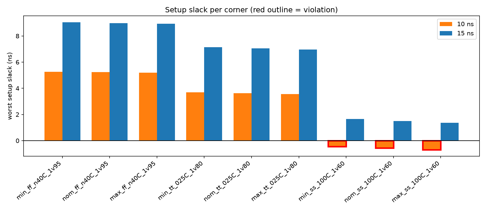
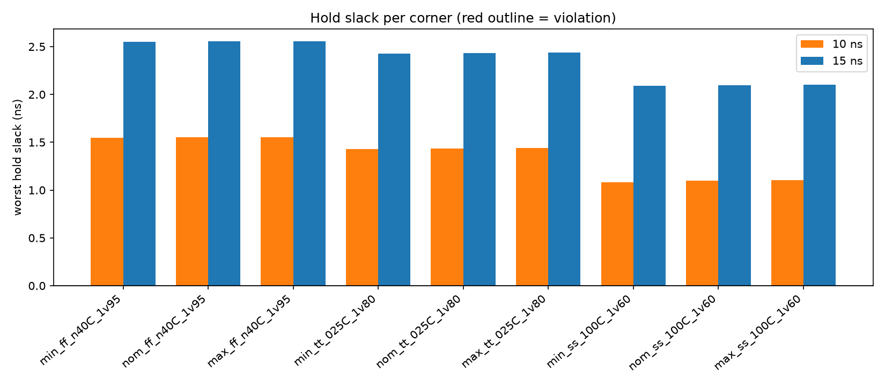
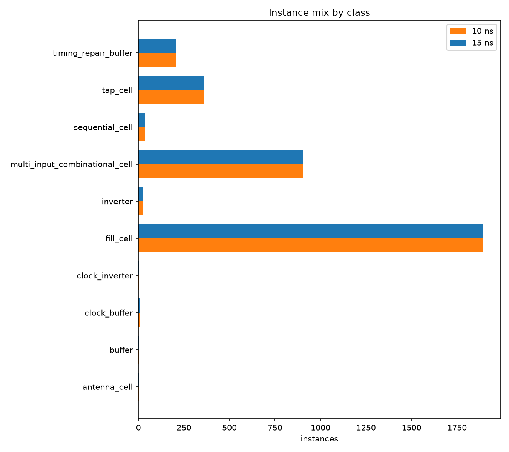
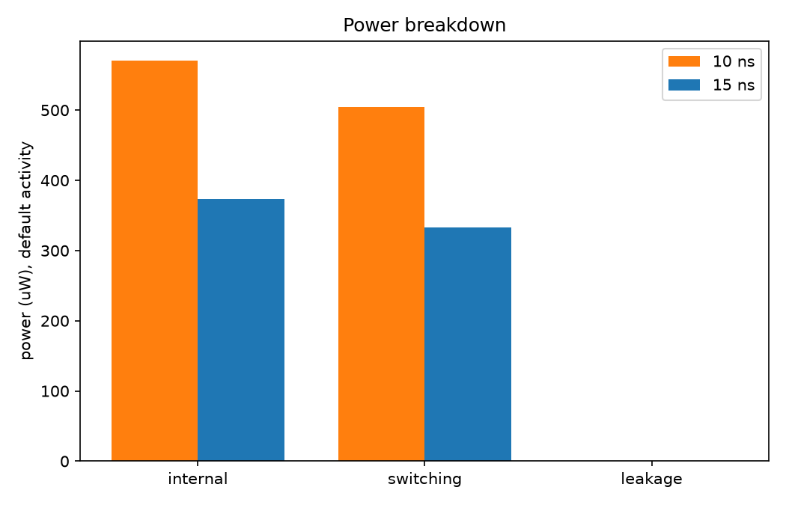
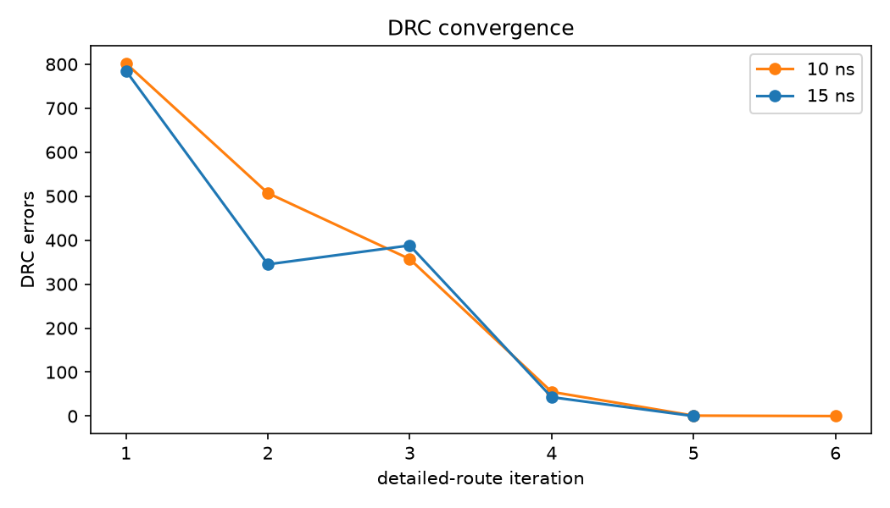
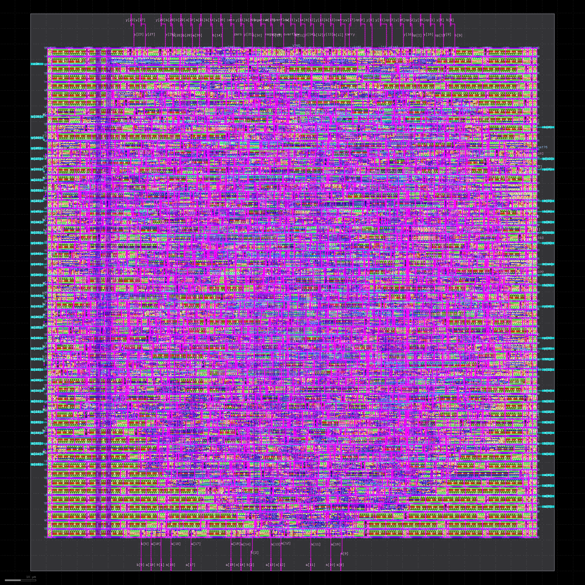

# 32-bit ALU: RTL to GDS on SkyWater sky130


A 32-bit ALU with twelve operations and four status flags, written in Verilog, verified in RTL and gate-level simulation, and taken through the complete open-source physical design flow (synthesis, floorplan, placement, clock tree, routing and signoff) with OpenLane 2 on the sky130 PDK. The design was implemented twice, at 10 ns and 15 ns clock targets, to find where timing closes.

## Results at a glance

| | |
|---|---|
| RTL simulation | 20,864 tests, 0 errors |
| Gate-level simulation (10 ns and 15 ns netlists) | 20,864 tests, 0 errors, both runs |
| Signoff (both runs) | 0 DRC errors (route, Magic, KLayout), 0 LVS errors, 0 antenna violations |
| 15 ns run | Setup and hold met at all 9 corners (worst setup slack +1.36 ns) |
| 10 ns run | Fails setup at the slow corner (worst slack -0.70 ns); meets timing at typical and fast |
| Size | About 1,540 cells, 10,800 um^2 of cell area, 169.0 x 179.72 um die |

## Design

### Interface

| Port | Dir | Width | Description |
|---|---|---|---|
| `clk` | in | 1 | Clock |
| `rst_n` | in | 1 | Asynchronous active-low reset |
| `a`, `b` | in | 32 | Operands |
| `op` | in | 4 | Operation select |
| `y` | out | 32 | Result (registered) |
| `zero` | out | 1 | Result is all zeros |
| `carry` | out | 1 | Carry out (ADD), no-borrow (SUB) |
| `overflow` | out | 1 | Signed overflow (ADD, SUB) |
| `negative` | out | 1 | Result bit 31 |

### Operations

| op | Name | Result |
|----|------|--------|
| 0  | ADD  | a + b |
| 1  | SUB  | a - b |
| 2  | AND  | a & b |
| 3  | OR   | a \| b |
| 4  | XOR  | a ^ b |
| 5  | NOR  | ~(a \| b) |
| 6  | SLL  | a << b[4:0] |
| 7  | SRL  | a >> b[4:0] (logical) |
| 8  | SRA  | a >>> b[4:0] (arithmetic, sign-extended) |
| 9  | SLT  | 1 if signed a < b, else 0 |
| 10 | SLTU | 1 if unsigned a < b, else 0 |
| 11 | XNOR | ~(a ^ b) |
| 12-15 | (default) | 0 |

### Micro-architecture

```
 a[31:0] --+
 b[31:0] --+--> combinational ALU (case on op) --> result
 op[3:0] --+                                          |
                                                      v
                          output registers (clk, async rst_n)
                                                      |
                         y, zero, carry, overflow, negative
```

- Results and flags are registered, so outputs appear one clock cycle after the inputs.
- `carry` and `overflow` are set only for ADD and SUB and read 0 for every other operation.
- SUB is computed as `a + ~b + 1`, so `carry = 1` means no borrow.
- Shift amounts come from `b[4:0]`.

## Verification

A self-checking testbench (`tb/alu32_tb.v`) applies 20,864 test vectors, compares the design outputs and prints a PASS/FAIL summary.

| Stage | Netlist | Result | Log |
|---|---|---|---|
| RTL simulation | `rtl/alu32.v` | 20,864 tests, 0 errors, PASS | `sim/rtl_sim.log` |
| Gate-level simulation | 10 ns run netlist | 20,864 tests, 0 errors, PASS | `gls/run_10ns/gls_sim.log` |
| Gate-level simulation | 15 ns run netlist | 20,864 tests, 0 errors, PASS | `gls/run_15ns/gls_sim.log` |

To run the RTL simulation (Icarus Verilog):

```bash
iverilog -o sim.vvp rtl/alu32.v tb/alu32_tb.v
vvp sim.vvp
```

Expected output:

```
TESTS: 20864   ERRORS: 0   => PASS
```

The run also writes `alu32_tb.vcd`, which you can open in GTKWave.

## Physical implementation

**Flow:** Yosys synthesis, floorplan, placement, clock tree synthesis, global and detailed routing, static timing analysis, then DRC (Magic and KLayout), LVS (Netgen) and antenna checks. All steps ran in OpenLane 2 on sky130, ending in a GDSII layout.

### Results

| | 10 ns run | 15 ns run |
|---|---|---|
| Clock target | 10 ns | 15 ns |
| Instances | 1542 | 1543 |
| Instance area | 10,901.7 um^2 | 10,809.1 um^2 |
| Die size | 169.0 x 179.72 um | 169.0 x 179.72 um |
| Route / Magic / KLayout DRC errors | 0 / 0 / 0 | 0 / 0 / 0 |
| LVS errors | 0 | 0 |
| Antenna violating nets | 0 | 0 |
| Worst setup slack (9 corners) | **-0.70 ns** (max_ss_100C_1v60) | **+1.36 ns** (max_ss_100C_1v60) |
| Worst hold slack (9 corners) | +1.08 ns | +2.09 ns |

### Timing by process corner

Slack in ns with nominal parasitic extraction. The nine analysis corners are three PVT conditions times three extraction cases (min, nom, max); the worst of all nine is in the table above.

| Corner | Setup, 10 ns | Setup, 15 ns | Hold, 10 ns | Hold, 15 ns |
|---|---|---|---|---|
| ff, -40 C, 1.95 V | +5.23 | +8.98 | +1.55 | +2.55 |
| tt, 25 C, 1.80 V | +3.63 | +7.05 | +1.43 | +2.43 |
| ss, 100 C, 1.60 V | **-0.57** | +1.49 | +1.10 | +2.10 |

### What the two runs show

- At a 10 ns clock the design meets setup at typical and fast corners, but the slow corner (100 C, 1.60 V) misses by up to 0.70 ns. Hold is clean everywhere.
- Relaxing the clock to 15 ns closes timing at all nine corners, with at least 1.36 ns of setup margin.
- The tighter clock costs about 0.9% more cell area (10,901.7 vs 10,809.1 um^2), so the limit here is timing at the slow corner, not area.
- Both runs are DRC, LVS and antenna clean, so the 10 ns run is a legal layout that only fails slow-corner setup.

### Charts

| | |
|---|---|
|  |  |
|  |  |
|  | |

Power is estimated at the flow's default switching activity, so use it for comparison between the runs rather than as an absolute figure.

### Final layout (15 ns run)



## Repository structure

```
rtl/        alu32.v                   ALU design
tb/         alu32_tb.v                self-checking testbench
sim/        rtl_sim.log               RTL simulation log
gls/        run_10ns/, run_15ns/      gate-level simulation logs
results/    run_15ns/alu32.nl.v       synthesized gate-level netlist (15 ns run)
docs/       images/, plots/           layout image and result charts
```

The GDSII layouts and other generated flow files are binary and are not stored here. The layout image, charts and tables above summarize them.

## Tools

Icarus Verilog, GTKWave, Yosys, OpenLane 2 (OpenROAD, Magic, KLayout, Netgen), SkyWater sky130 open-source PDK.

## Author

Abhi ([@abhichandra586](https://github.com/abhichandra586))
